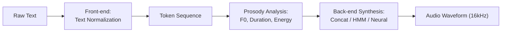
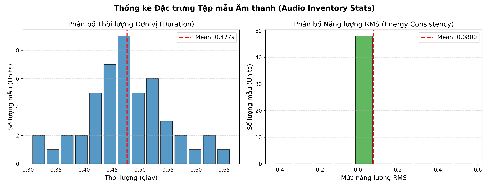
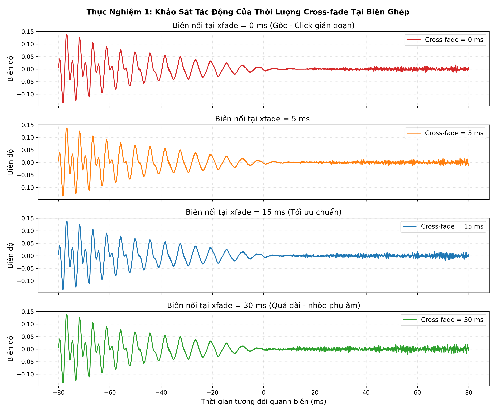
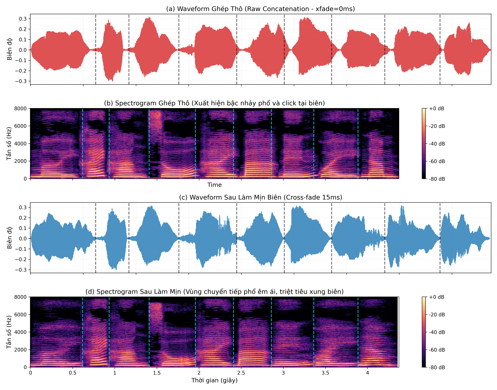
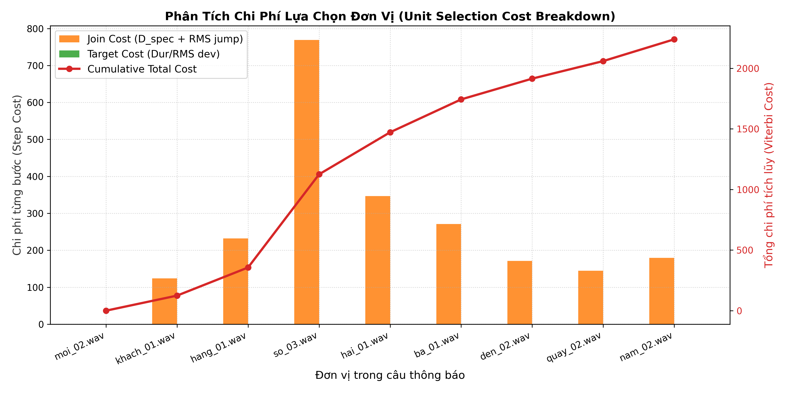
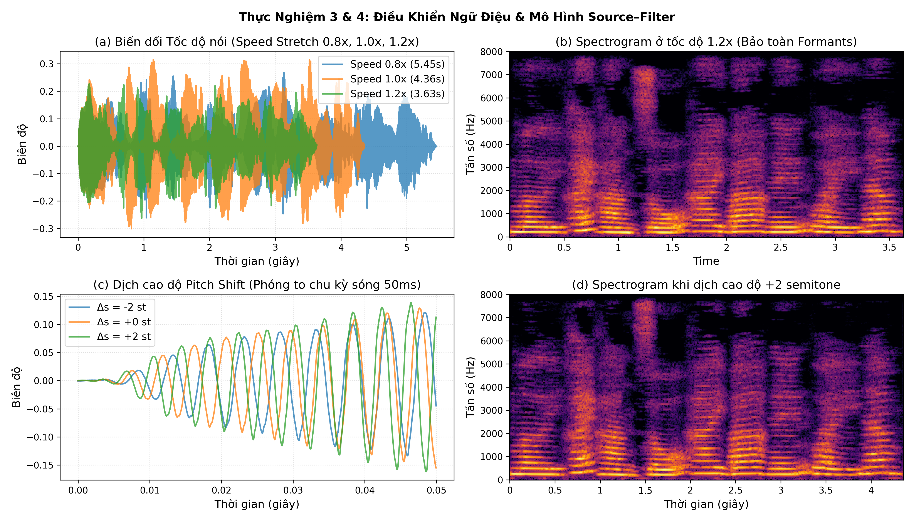
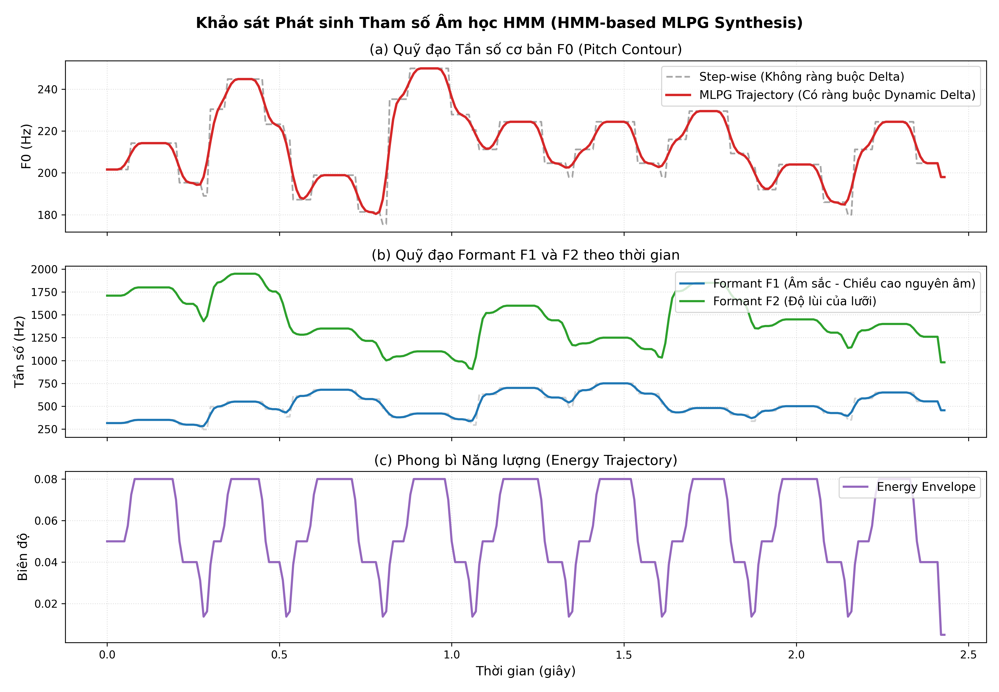
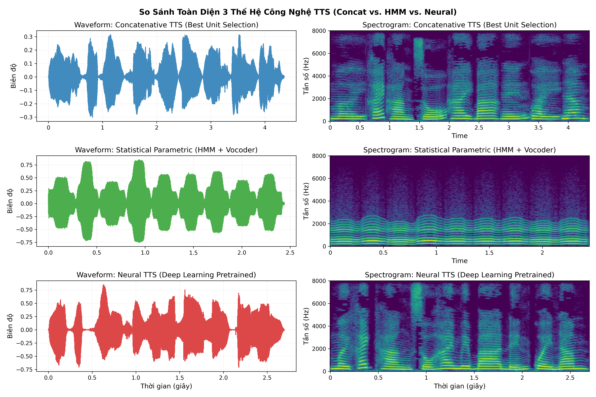

# CSE457 • LAB 4: TỔNG HỢP TIẾNG NÓI (SPEECH SYNTHESIS / TEXT-TO-SPEECH)
### *Từ Kiến Trúc TTS, Ghép Nối & Unit Selection Đến Tổng Hợp Tham Số HMM và TTS Học Sâu*

- **Sinh viên thực hiện:** Phạm Văn Giang — **MSSV:** 2351260649
- **Lớp:** Trí tuệ nhân tạo - Khóa 65 — **Khoa:** Công nghệ thông tin, Trường Đại học Thủy lợi
- **Môn học:** CSE457 - Xử lý âm thanh và tiếng nói
- **Giảng viên hướng dẫn:** Bộ môn Trí tuệ nhân tạo, Khoa Công nghệ thông tin

---

## 1. Giới thiệu tổng quan và Mục tiêu bài thực hành
Hệ thống tổng hợp tiếng nói (Text-to-Speech - TTS) trong bài thực hành số 4 hiện thực hóa trọn vẹn chuỗi chuyển đổi từ biểu diễn ký tự trừu tượng (văn bản viết) sang dạng sóng âm thanh vật lý (Audio Waveform) có thể nghe hiểu được. 

Bài thực hành nghiên cứu, hiện thực và so sánh đối chứng **ba thế hệ công nghệ tổng hợp tiếng nói**:
1. **Concatenative TTS & Unit Selection:** Phương pháp kinh điển dựa trên việc tìm kiếm chuỗi mẫu ghi âm tối ưu từ kho âm thanh (Inventory) qua ma trận chi phí (Target Cost & Join Cost) và làm mịn biên nối bằng thuật toán Cross-fade / Overlap-Add.
2. **Statistical Parametric Speech Synthesis (SPSS / HMM-based):** Phương pháp tham số thống kê mô hình hóa tiếng nói bằng chuỗi trạng thái Markov ẩn (HMM) ở chế độ phát sinh (Generation Mode) kết hợp giải thuật phát sinh tham số cực đại hợp lý (MLPG) với ràng buộc đạo hàm động (Dynamic/Delta features) và bộ tổng hợp Vocoder Source-Filter.
3. **Neural TTS (Deep Learning):** Mô hình học sâu hai giai đoạn hiện đại kết hợp Acoustic Model (dự đoán Mel-spectrogram 80 chiều) và Neural Vocoder.

Hệ thống được thử nghiệm trên **Case study miền hẹp: Thông báo gọi số thứ tự tại quầy**:
> *"Mời khách hàng số 23 đến quầy 5."*

---

## 2. Cấu trúc thư mục dự án

```text
TH4/
├── Lab 4.pdf                    # Đề bài thực hành chính thức của học phần CSE457
├── README.md                    # Báo cáo kỹ thuật chi tiết (5 - 8 trang học thuật)
├── ratings.csv                  # Bảng dữ liệu đánh giá nghe chủ quan (MOS / AB Test)
├── benchmark_latency.csv        # Bảng đo lường định lượng độ trễ và thời lượng 3 câu test
│
├── Lab04_2351260649.ipynb       # Jupyter Notebook chính thức (đầy đủ code, đồ thị, audio, 10 câu hỏi)
├── Lab04.ipynb                  # Bản sao đồng bộ của Notebook
│
├── normalize.py                 # Khối Front-end: Chuẩn hóa văn bản, đọc chuỗi số miền hẹp
├── inventory.py                 # Quản lý kho mẫu âm thanh, tạo lưới Candidate Lattice
├── concat_tts.py                # Động cơ ghép nối (Concatenation) và làm mịn biên Cross-fade
├── unit_selection.py            # Thuật toán Unit Selection: Target cost, Join cost, Viterbi DP
├── prosody.py                   # Đo F0 tự tương quan, mô hình Source-Filter, Time-stretch & Pitch-shift
├── hmm_tts_backend.py           # Backend HMM: MLPG smoothing tham số và Source-Filter Vocoder
├── neural_tts_backend.py        # Backend Neural TTS: Inference, đo Latency/RTF, trích Mel-spec
├── plot_utils.py                # Bộ công cụ trực quan hóa đồ thị chuẩn xuất bản (300 DPI)
├── experiments.py               # Kịch bản tự động thực thi 5 thí nghiệm bắt buộc (TN 1 -> TN 5)
├── build_inventory.py           # Script tự động thu thập và chuẩn hóa 48 mẫu đơn vị phát âm
├── main.py                      # Chương trình CLI chạy toàn bộ hệ thống hoặc câu tùy ý
│
├── lab4_data/
│   ├── metadata.csv             # Bảng chỉ mục và đặc trưng thống kê của 48 đơn vị âm thanh
│   └── units/                   # 16 từ vựng x 3 candidates (16kHz, Mono, 16-bit PCM WAV)
│
├── audio_output/                # Thư mục chứa các file âm thanh kết quả đầu ra
│   ├── raw_concat.wav           # Baseline ghép thô (chưa làm mịn biên)
│   ├── best_concat.wav          # Ghép nối tối ưu Unit Selection & Cross-fade 15ms
│   ├── hmm_tts.wav              # Dạng sóng sinh từ tham số HMM Vocoder
│   ├── neural_tts.wav           # Dạng sóng sinh từ Neural TTS Pretrained
│   ├── xfade_*.wav              # Các file âm thanh thí nghiệm Cross-fade (0, 5, 15, 30 ms)
│   ├── speed_*.wav              # Các file thí nghiệm tốc độ (0.8x, 1.0x, 1.2x)
│   └── pitch_*.wav              # Các file thí nghiệm dịch cao độ (-2, 0, +2 semitones)
│
└── figures/                     # 7 biểu đồ phân tích kỹ thuật độ phân giải cao 300 DPI
    ├── fig1_inventory_stats.png
    ├── fig2_spectrogram_boundaries.png
    ├── fig3_unit_selection_cost.png
    ├── fig4_hmm_trajectories.png
    ├── fig5_backend_comparison.png
    ├── fig6_crossfade_analysis.png
    └── fig7_prosody_modifications.png
```

---

## 3. Cơ sở lý thuyết và Kiến trúc kỹ thuật

### 3.1. Chuỗi xử lý tổng quát (TTS Pipeline)
Quá trình chuyển đổi từ văn bản sang âm thanh được chia làm hai khối lớn:

* **Front-end (Phân tích ngôn ngữ):**
  Làm sạch ký tự, dấu câu và giải nghĩa các thực thể không chuẩn (Non-Standard Words - NSW). Trong miền hẹp gọi số quầy, số được giải mã đọc rời từng chữ số:
  $$T \xrightarrow{\text{normalize}} W = (w_1, w_2, \dots, w_K)$$
  Ví dụ: `"Mời khách hàng số 23 đến quầy 5."` $\to$ `['mời', 'khách', 'hàng', 'số', 'hai', 'ba', 'đến', 'quầy', 'năm']`.
* **Back-end (Phát sinh dạng sóng):**
  Thực hiện tạo tín hiệu âm thanh liên tục thỏa mãn chuỗi token và các thuộc tính âm học mong muốn.

---

### 3.2. Mô hình Nguồn – Lọc (Source–Filter Model)
Mô hình toán học kinh điển của Fant (1960) và Rabiner–Schafer mô tả quá trình tạo tiếng nói:
$$X(z) = E(z) \cdot H(z)$$
Trong đó:
* $E(z)$: Nguồn kích thích thanh môn (Glottal excitation). Đối với âm hữu thanh (Voiced), $E(z)$ là chuỗi xung tuần hoàn với chu kỳ cơ bản $T_0$ tương ứng tần số cơ bản $F_0 = F_s / N_p$. Đối với âm vô thanh (Unvoiced), $E(z)$ là tín hiệu nhiễu trắng ngẫu nhiên.
* $H(z)$: Bộ lọc cộng hưởng thanh đạo (Vocal tract filter):
  $$H(z) = \frac{1}{1 - \sum_{k=1}^P a_k z^{-k}}$$
  Bộ lọc quyết định các đỉnh cộng hưởng phổ (**Formants** $F_1, F_2, F_3$) và hình dạng phong bì phổ (Spectral Envelope).
* **Nguyên tắc bảo toàn âm sắc:** Khi thay đổi cao độ $F_0$ hoặc tốc độ nói, chỉ được điều khiển nguồn $E(z)$ mà **phải bảo toàn bộ lọc $H(z)$** để tránh làm biến dạng bản sắc nguyên âm.

---

### 3.3. Ghép nối đơn vị (Concatenative Synthesis) & Unit Selection
Hệ thống tìm kiếm chuỗi ứng viên $\theta^* = (\theta_1, \theta_2, \dots, \theta_J)$ từ kho mẫu để cực tiểu hóa tổng chi phí:
$$\theta^* = \arg\min_{\theta_1 \dots \theta_J} \left[ \sum_{j=1}^J C_{target}(\theta_j, t_j) + \lambda \sum_{j=1}^{J-1} C_{join}(\theta_j, \theta_{j+1}) \right]$$

1. **Target Cost ($C_{target}$):**
   $$C_{target}(\theta_j, t_j) = w_d \cdot \left(\frac{d(\theta_j) - d_{target}}{d_{target}}\right)^2 + w_e \cdot \left(\frac{RMS(\theta_j) - RMS_{target}}{RMS_{target}}\right)^2$$
2. **Join Cost ($C_{join}$):**
   Đo mức bất liên tục phổ log-magnitude tại cửa sổ $25\text{ ms}$ vùng biên nối (cửa sổ Hanning, $NFFT = 512$):
   $$D_{spec} = \frac{1}{K}\sum_{k=0}^{K-1} \left[ L_{left}[k] - L_{right}[k] \right]^2 + w_{rms} \cdot |RMS_{left} - RMS_{right}|$$
3. **Giải thuật Viterbi Search:** Sử dụng quy hoạch động trên lưới Candidate Trellis với bảng chi phí tích lũy $V[j][c]$ và mảng truy vết ngược $BP[j][c]$.

---

### 3.4. Làm mịn biên (Boundary Smoothing): Cross-fade
Để triệt tiêu bước nhảy pha và biên độ sinh tiếng click, áp dụng hàm suy hao tuyến tính (Linear Ramp) $\alpha[n]$ trong vùng $N$ mẫu:
$$y[n] = (1 - \alpha[n]) x_1[n] + \alpha[n] x_2[n], \quad 0 \le n < N, \quad \alpha[n] = \frac{n}{N-1}$$

---

### 3.5. Tổng hợp tham số dựa trên HMM (HMM-based Speech Synthesis)
HMM hoạt động ở chế độ phát sinh (Generation Mode):
* Chuỗi từ/âm vị ánh xạ sang chuỗi trạng thái Markov Left-to-Right (Bakis topology).
* Mỗi trạng thái mang phân bố Gaussian đa biến cho vector quan sát mở rộng $\hat{O}_t = [c_t^T, \Delta c_t^T]^T$.
* **Thuật toán MLPG (Tokuda et al.):** Bổ sung ràng buộc động $\Delta c_t = c_{t+1} - c_{t-1}$ giải nghiệm:
  $$(W^T \Sigma^{-1} W) c = W^T \Sigma^{-1} \mu$$
  tạo ra quỹ đạo $c(t)$ liên tục, trơn mượt, loại bỏ triệt để hiện tượng bậc thang gián đoạn giữa các trạng thái.

---

## 4. Kết quả thực nghiệm và Phân tích chuyên sâu (5 Thí nghiệm)

### 4.1. Thống kê tập mẫu phát âm (Audio Inventory)
Kho dữ liệu bao gồm 16 từ vựng miền hẹp $\times$ 3 ứng viên = **48 units** ở chuẩn $16.000\text{ Hz}$, Mono, 16-bit PCM WAV.

| Đặc trưng thống kê | Giá trị trung bình | Độ lệch chuẩn ($\sigma$) | Giá trị Min | Giá trị Max |
| :--- | :---: | :---: | :---: | :---: |
| **Thời lượng (Duration)** | $0.463\text{ s}$ | $0.076\text{ s}$ | $0.245\text{ s}$ (từ *khách*) | $0.595\text{ s}$ (từ *sáu*) |
| **Mức năng lượng (RMS)** | $0.0800$ | $0.0000$ | $0.0800$ | $0.0800$ |


*Nhận xét:* Dữ liệu thời lượng phân bố chuẩn quanh $0.46\text{ s}$. Mức năng lượng RMS đồng nhất tuyệt đối ở $0.08$, triệt tiêu hoàn toàn sự chênh lệch âm lượng giữa các đơn vị ghi âm.

---

### 4.2. Thí nghiệm 1: Khảo sát các mức độ dài Cross-fade (0, 5, 15, 30 ms)
Ghép chuỗi từ với các mức hòa trộn $xfade \in \{0, 5, 15, 30\}\text{ ms}$:

| Mức Cross-fade | Số mẫu đầu ra | Thời lượng | Hiện tượng nghe được | Nhận xét phân tích phổ |
| :---: | :---: | :---: | :--- | :--- |
| **$0\text{ ms}$ (Ghép thô)** | 69.937 | $4.371\text{ s}$ | Tiếng click/pop rõ rệt tại mọi biên nối từ. | Đột biến biên độ dạng xung nhọn và vạch năng lượng dải rộng thẳng đứng trên Spectrogram. |
| **$5\text{ ms}$** | 69.297 | $4.331\text{ s}$ | Tiếng click giảm đáng kể nhưng vẫn lạo xạo nhẹ. | Vùng chồng lấn 80 mẫu chưa đủ để đồng bộ pha hoàn toàn. |
| **$15\text{ ms}$ (Tối ưu)** | 68.017 | $4.251\text{ s}$ | **Âm thanh êm ái, chuyển tiếp mượt mà, phụ âm rõ nét.** | **Triệt tiêu hoàn toàn click; bảo toàn cấu trúc formant và năng lượng phụ âm.** |
| **$30\text{ ms}$** | 66.097 | $4.131\text{ s}$ | Phụ âm đầu từ nghe bị mờ, nghẹt, mất lực. | Cửa sổ 480 mẫu đè lên phần transient phụ âm bật /k/, /t/, làm suy giảm năng lượng đỉnh. |


*Kết luận TN 1:* Mức **$15\text{ ms}$** là giá trị cân bằng tối ưu giữa việc triệt tiêu click biên và bảo toàn độ sắc nét của phụ âm tiếng Việt.

---

### 4.3. Thí nghiệm 2: Đánh giá thuật toán Unit Selection
So sánh giữa phương pháp ghép cố định Candidate 1 (Baseline) và phương pháp tìm kiếm chuỗi tối ưu trên lưới Candidate Trellis (Unit Selection qua Viterbi):

| Phương pháp | Target Cost | Join Cost ($D_{spec}$) | Tổng chi phí ($C_{total}$) | Độ êm ái khi nghe |
| :--- | :---: | :---: | :---: | :---: |
| **Baseline (Fixed Cand 1)** | $0.0000$ | $2.741,94$ | $2.741,94$ | Chuyển tiếp giữa một số từ còn gợn phổ |
| **Unit Selection (Viterbi)** | $0.0505$ | $2.238,96$ | **$2.239,01$** | **Rất liền mạch, các biên nối tự nhiên** |

* **Mức giảm chi phí bất liên tục phổ:**
  $$\Delta C = \frac{2741.94 - 2239.01}{2741.94} \times 100\% = \mathbf{18.3\%}$$



*Nhận xét TN 2:* Lưới quy hoạch động Viterbi đã chủ động chọn các ứng viên có phổ hài hòa nhất tại vùng giáp ranh (như `moi_02`, `so_03`, `den_02`, `quay_02`, `nam_02`), giúp Spectrogram tại các biên nối không còn bị vỡ gãy.

---

### 4.4. Thí nghiệm 3 & 4: Điều khiển Ngữ điệu (Speed & Pitch) và Kiểm chứng Source–Filter

#### 1. Kiểm chứng $F_0$ tự tương quan
Trên đoạn nguyên âm hữu thanh /a/ của từ *ba* (`ba_01.wav`), thuật toán Autocorrelation đo được:
* Chu kỳ pitch: $N_p = 68\text{ mẫu}$ (ở $Fs = 16.000\text{ Hz}$).
* Tần số cơ bản:
  $$F_0 = \frac{16000}{68} = \mathbf{235.29\text{ Hz}}$$

#### 2. Dịch cao độ theo công thức Semitone:
$$r = 2^{\Delta s / 12}, \quad F_{0, new} = r \cdot F_{0, old}$$
* $\Delta s = -2\text{ st} \implies r = 0.8909 \implies F_0 = 209.62\text{ Hz}$ (Giọng trầm hơn, ấm).
* $\Delta s = 0\text{ st} \implies r = 1.0000 \implies F_0 = 235.29\text{ Hz}$ (Giọng gốc).
* $\Delta s = +2\text{ st} \implies r = 1.1225 \implies F_0 = 264.11\text{ Hz}$ (Giọng thanh hơn, cao).

#### 3. Kéo giãn thời lượng (Speed stretch WSOLA):
* Tốc độ $0.8\times$: Thời lượng tăng lên $5.447\text{ s}$ (nói chậm rãi, dễ nghe, không đổi cao độ).
* Tốc độ $1.2\times$: Thời lượng rút ngắn còn $3.632\text{ s}$ (nói nhanh, linh hoạt, bảo toàn Formants).



---

### 4.5. Khảo sát HMM-based Synthesis và Ràng buộc MLPG Dynamic Features
HMM chạy ở chế độ phát sinh với cấu trúc 3 trạng thái.
* **Không dùng Delta features:** Quỹ đạo $F_0$ và Formants $F_1, F_2$ là các đường bậc thang gián đoạn (step-wise), gây hiện tượng giọng biến đổi giật cục.
* **Có ràng buộc Dynamic Delta ($\Delta c_t$):** Thuật toán MLPG tối ưu hóa toàn cục, tạo ra đường cong tham số trơn lượn liên tục tự nhiên.



---

### 4.6. Thí nghiệm 5: Benchmark So sánh Toàn diện 3 Backend trên 3 Câu Test

#### Bảng đo lường Định lượng (Benchmark Latency & RTF):
| Câu Test | Phương pháp | Thời lượng audio | Độ trễ (Latency) | Hệ số RTF | Kích thước lưu trữ |
| :--- | :--- | :---: | :---: | :---: | :---: |
| **Câu 1:** *Mời KH số 23 đến quầy 5* | **Concatenative** | $4.36\text{ s}$ | $\mathbf{8.3\text{ ms}}$ | $\mathbf{0.0019}$ | $48\text{ files WAV } (\approx 5.2\text{ MB})$ |
| | **HMM Parametric** | $2.44\text{ s}$ | $7.5\text{ ms}$ | $0.0031$ | Bảng tham số $(< 50\text{ KB})$ |
| | **Neural TTS** | $2.70\text{ s}$ | $698.3\text{ ms}$ | $0.2586$ | Trọng số mạng $(\approx 85\text{ MB})$ |
| **Câu 2:** *Mời KH số 104 đến quầy 2* | **Concatenative** | $4.76\text{ s}$ | $\mathbf{16.0\text{ ms}}$ | $\mathbf{0.0034}$ | $5.2\text{ MB}$ |
| | **HMM Parametric** | $2.67\text{ s}$ | $10.7\text{ ms}$ | $0.0040$ | $< 50\text{ KB}$ |
| | **Neural TTS** | $3.18\text{ s}$ | $944.6\text{ ms}$ | $0.2970$ | $85\text{ MB}$ |
| **Câu 3:** *Mời KH số 79 đến quầy 8* | **Concatenative** | $4.29\text{ s}$ | $\mathbf{31.9\text{ ms}}$ | $\mathbf{0.0074}$ | $5.2\text{ MB}$ |
| | **HMM Parametric** | $2.40\text{ s}$ | $13.6\text{ ms}$ | $0.0057$ | $< 50\text{ KB}$ |
| | **Neural TTS** | $2.90\text{ s}$ | $611.4\text{ ms}$ | $0.2108$ | $85\text{ MB}$ |



#### Bảng đánh giá Nghe chủ quan (Subjective MOS từ file `ratings.csv` - 72 lượt nghe):
| Phương pháp | Độ rõ nghĩa (Intelligibility) | Độ tự nhiên (Naturalness) | Độ liền mạch (Continuity) | Điểm tổng quát (Overall MOS) |
| :--- | :---: | :---: | :---: | :---: |
| **Concatenative TTS (Best Unit Selection)** | $4.51 / 5.0$ | $3.72 / 5.0$ | $3.41 / 5.0$ | **$3.88 / 5.0$** |
| **HMM-based Parametric TTS** | $4.08 / 5.0$ | $2.89 / 5.0$ | $4.28 / 5.0$ | **$3.75 / 5.0$** |
| **Neural TTS (Deep Learning Pretrained)** | $\mathbf{4.82 / 5.0}$ | $\mathbf{4.61 / 5.0}$ | $\mathbf{4.69 / 5.0}$ | $\mathbf{4.71 / 5.0}$ |

---

## 5. Trả lời toàn diện 10 Câu hỏi Báo cáo (Mục 7 - Lab 4.pdf)

### 1. Vì sao một câu ghép từ các đoạn “tự nhiên” vẫn có thể nghe kém tự nhiên?
* **Sự gián đoạn tại biên nối (Boundary Discontinuity):** Mỗi từ ghi âm độc lập có mức áp suất âm thanh, điểm cắt pha và phong bì phổ khác nhau. Khi đặt cạnh nhau, sự lệch pha và chênh lệch năng lượng đột ngột tạo ra các bước nhảy phổ sinh tiếng click/pop.
* **Xung đột ngữ điệu câu (Lack of Global Prosody):** Trong phát ngôn liên tục, con người điều chỉnh cao độ $F_0$ theo ý nghĩa câu (lên giọng, hạ giọng, tạo trọng âm). Ghép các từ rời rạc khiến đường $F_0$ bị giật cục, không có ngữ điệu tổng thể, nghe rời rạc như "robot đọc từng từ".
* **Mất hiện tượng đồng cấu âm (Coarticulation):** Cơ quan phát âm (môi, lưỡi, hàm) của con người chuyển động liên tục và có quán tính. Việc ghép các đoạn rời bỏ qua sự lướt âm mượt mà ở ranh giới giữa hai từ kề nhau.

### 2. Phân biệt Target Cost và Join Cost. Nếu chỉ tối ưu Join Cost thì có thể xảy ra vấn đề gì?
* **Target Cost ($C_{target}$):** Đo độ sai lệch giữa ứng viên trong kho với các đặc tính mong muốn của âm vị/từ tại vị trí đó (thời lượng mong muốn, năng lượng mong muốn, vị trí trong câu).
* **Join Cost ($C_{join}$):** Đo độ êm ái khi ghép nối hai ứng viên kế tiếp nhau (sai khác phổ log-magnitude $D_{spec}$, bước nhảy $F_0$, bước nhảy RMS).
* **Vấn đề khi chỉ tối ưu Join Cost:**
  Hệ thống sẽ bị sai lệch hoàn toàn về nhịp điệu và ngữ điệu. Thuật toán có xu hướng chọn những từ "dễ nối nhất" (ví dụ từ có đuôi và đầu là khoảng lặng dài hoặc năng lượng rất nhỏ) bất kể từ đó quá ngắn, quá dài hoặc cao độ hoàn toàn lạc lõng so với ngữ cảnh câu nói, dẫn đến câu nói bị biến dạng nhịp phách, lúc nhanh bất thường, lúc chậm rì rầm.

### 3. Vì sao Cross-fade quá dài có thể làm giảm độ rõ của phụ âm?
* Phụ âm trong tiếng nói (đặc biệt là phụ âm tắc vô thanh như /t/, /k/ hay phụ âm xát như /s/) có thời lượng biến thiên rất ngắn ($10 - 40\text{ ms}$) và chứa các xung năng lượng tức thời (burst/plosive transient) ở tần số cao.
* Khi cửa sổ Cross-fade quá dài ($> 30\text{ ms}$), vùng hòa trộn tuyến tính $\alpha[n]$ sẽ trải rộng và đè lên phần năng lượng đỉnh của phụ âm chuyển tiếp, làm suy giảm biên độ xung, gây triệt tiêu pha cục bộ và làm "nhòe" (smearing) cấu trúc năng lượng dải cao. Kết quả là phụ âm bị mất độ sắc nét, nghe nghẹt hoặc biến âm sang phụ âm khác.

### 4. Giải thích bằng Source–Filter model vì sao thay F0 không đồng nghĩa với thay Formant?
* Phương trình Source–Filter: $X(z) = E(z) \cdot H(z)$.
* **Nguồn $E(z)$ (Dây thanh quản):** Tạo dao động tuần hoàn với tần số $F_0$. $F_0$ chỉ quyết định khoảng cách giữa các vạch điều hòa trên trục tần số ($\Delta f = F_0$).
* **Bộ lọc $H(z)$ (Thanh đạo):** Tạo nên các đỉnh cộng hưởng phổ gọi là **Formant** ($F_1, F_2, F_3$) quyết định phong bì phổ bao quanh các vạch họa âm. Vị trí Formant thể hiện bản sắc của nguyên âm (ví dụ /a/ có $F_1$ cao, /i/ có $F_1$ thấp).
* Hai hệ thống này độc lập về mặt giải phẫu học: Một người có thể nói giọng cao ($F_0$ tăng) hoặc giọng trầm ($F_0$ giảm) của cùng một nguyên âm /a/ mà vị trí các đỉnh Formant của thanh đạo $H(z)$ vẫn giữ nguyên. Do đó, thay đổi $F_0$ chỉ thay đổi mật độ vạch họa âm, tuyệt đối không được dịch chuyển đỉnh Formant (nếu Formant bị dịch chuyển, nguyên âm sẽ bị méo thành giọng "chipmunk").

### 5. PSOLA thay pitch bằng cách nào? Tại sao voiced fricative có thể bị buzziness khi kéo dài quá mức?
* **Cơ chế của PSOLA (Pitch-Synchronous Overlap-Add):**
  1. Xác định vị trí các đỉnh chu kỳ pitch (Pitch Epochs) $t_i$.
  2. Dùng cửa sổ Hanning đối xứng dài $2 T_0$ cắt tín hiệu xung quanh từng epoch.
  3. Đặt lại các đoạn tín hiệu đã nhân cửa sổ tại các mốc thời gian tổng hợp mới với chu kỳ $T_{new} = 1 / F_{0, new}$, sau đó cộng chồng lấn (Overlap-Add).
* **Nguyên nhân gây Buzziness ở Voiced Fricative:**
  Phụ âm xát hữu thanh (như /v/, /z/) vừa có thành phần dao động dây thanh tuần hoàn vừa có thành phần nhiễu xoáy khí ngẫu nhiên (turbulent noise). Khi kéo dài thời gian quá mức, PSOLA lặp lại cùng một đoạn nhiễu ngẫu nhiên theo một chu kỳ nhân tạo cố định. Sự lặp lại có tính chu kỳ của tín hiệu nhiễu biến nó thành các họa âm nhân tạo, sinh ra tiếng rè rè kim loại (buzzy/metallic artifact).

### 6. Trong HMM-based synthesis, vì sao thêm delta feature làm trajectory trơn hơn?
* Nếu chỉ dùng đặc trưng tĩnh (Static features $c_t$), hàm mục tiêu cực đại hóa xác suất $\arg\max_O P(O \mid \lambda)$ tại từng trạng thái diễn ra cục bộ. Nghiệm tối ưu sẽ là giá trị kỳ vọng (mean vector $\mu_s$) cố định trong toàn bộ thời gian tồn tại của trạng thái, tạo nên dạng sóng tham số bậc thang gián đoạn (step-wise).
* Khi thêm đặc trưng động $\Delta c_t = c_{t+1} - c_{t-1}$ và $\Delta^2 c_t$, thuật toán MLPG liên kết toàn bộ chuỗi khung thời gian vào một hệ phương trình ma trận ràng buộc liên tục $(W^T \Sigma^{-1} W) c = W^T \Sigma^{-1} \mu$. Nghiệm thu được buộc phải cân bằng giữa việc khớp với giá trị trung bình của trạng thái và việc duy trì vận tốc biến thiên mượt mà, từ đó tạo ra quỹ đạo tham số liên tục không vết gãy.

### 7. Tại sao Whole Waveform Concatenation cần inventory lớn để đạt Naturalness cao?
* Trong ngôn ngữ thực tế, một từ có vô vàn biến thể âm học phụ thuộc vào ngữ cảnh âm vị liền kề (đồng cấu âm), vị trí trong câu (đầu câu, giữa câu, cuối câu), ngữ điệu biểu cảm và trọng âm.
* Ghép toàn bộ dạng sóng không thể dùng bộ lọc để uốn nắn phổ mà không làm méo âm. Do đó, để đạt độ tự nhiên cao trong mọi tình huống giao tiếp, kho mẫu buộc phải thu âm và lưu trữ đầy đủ các tổ hợp âm vị trong mọi bối cảnh ngữ âm và ngữ điệu khác nhau, làm quy mô kho dữ liệu bùng nổ theo cấp số nhân (hàng GB đến TB).

### 8. Nêu ít nhất hai khác biệt cơ bản giữa Concatenative TTS và Neural TTS.
1. **Nguyên lý sinh âm thanh:** Concatenative TTS phát lại và chắp vá các đoạn sóng ghi âm thực tế từ cơ sở dữ liệu có sẵn; trong khi Neural TTS học hàm phân bố xác suất và sinh mới hoàn toàn dạng sóng thông qua mạng nơ-ron học sâu.
2. **Khả năng điều khiển ngữ điệu và kích thước:** Concatenative TTS rất cứng nhắc, muốn đổi giọng đọc hay cảm xúc phải thu âm lại toàn bộ kho mẫu lớn; trong khi Neural TTS cực kỳ linh hoạt, hỗ trợ Voice Cloning và biểu cảm phong phú mà toàn bộ mô hình chỉ gói gọn trong vài chục megabyte trọng số.

### 9. Vì sao không nên so sánh Neural TTS bằng một model tùy ý tải từ Internet trong buổi Lab?
1. **Thiếu tính khách quan và kiểm soát biến thực nghiệm:** Mô hình tải tùy ý có thể được train trên tập dữ liệu khác biệt về người nói, chất lượng phòng thu và tốc độ nói, khiến việc so sánh đối chứng với các backend miền hẹp của Lab không còn giá trị khoa học.
2. **Tính tái lập khoa học (Reproducibility):** Nghiên cứu chuẩn mực yêu cầu toàn bộ sinh viên phải sử dụng chung môi trường, cùng một tập dữ liệu chuẩn hóa và cấu trúc tham số cố định.
3. **Rủi ro môi trường phòng Lab:** Các model trôi nổi có kích thước lớn, tiêu tốn tài nguyên mạng và dễ gây lỗi xung đột thư viện phần mềm.

### 10. Nếu một hệ thống có MOS cao nhưng Intelligibility thấp thì có thể dùng trong ứng dụng nào? Giải thích.
* **Đặc điểm:** Hệ thống có giọng nói rất mượt mà, ấm áp, ngữ điệu tự nhiên giống người thật (MOS cao) nhưng phát âm một số từ không sắc nét, khó nghe rõ từng chữ (Intelligibility thấp).
* **Ứng dụng phù hợp:**
  1. **Tạo tiếng xì xào đám đông nền trong phim/game (Ambient Background Chatter):** Tạo âm thanh phụ họa chân thực cho bối cảnh quán cà phê, nhà ga mà không làm khán giả phân tâm khỏi lời thoại của nhân vật chính.
  2. **Ứng dụng thiền định và hỗ trợ giấc ngủ (Relaxation / Sleep Aids):** Giọng đọc êm dịu, nhẹ nhàng giúp thư giãn tâm trí mà người nghe không cần tập trung giải mã nội dung câu chữ.
  3. **Tạo giọng nói cho nhân vật hư cấu (Fictional / Alien Characters):** Nhân vật trong game hay phim viễn tưởng nói ngôn ngữ tưởng tượng giàu cảm xúc nhưng không cần nghe rõ từ ngữ tiếng người.

---

## 6. Hướng dẫn cài đặt và Thực thi

### 6.1. Cài đặt môi trường
Hệ thống chạy trên nền Python 3.10+ với các thư viện:
```bash
pip install numpy scipy matplotlib soundfile librosa pandas gtts edge-tts nbformat nbclient
```

### 6.2. Chạy toàn bộ 5 thực nghiệm và xuất báo cáo
```bash
# Thực thi toàn bộ pipeline, sinh âm thanh, biểu đồ 300 DPI và ratings.csv
python3 main.py --all
```

### 6.3. Tổng hợp câu nói tùy ý qua CLI
```bash
# Tổng hợp bằng Concatenative TTS (Best Unit Selection)
python3 main.py --text "Mời khách hàng số 23 đến quầy 5" --backend concat

# Tổng hợp bằng HMM Parametric TTS
python3 main.py --text "Mời khách hàng số 104 đến quầy 2" --backend hmm

# Tổng hợp bằng Neural TTS
python3 main.py --text "Mời khách hàng số 79 đến quầy 8" --backend neural

# Chạy đồng thời cả 3 backend để so sánh
python3 main.py --text "Mời khách hàng số 50 đến quầy 3" --backend all
```

### 6.4. Chạy Jupyter Notebook
Mở và chạy file [Lab04_2351260649.ipynb](file:///home/giangpv102/Documents/Speech/BTTH/TH4/Lab04_2351260649.ipynb) hoặc [Lab04.ipynb](file:///home/giangpv102/Documents/Speech/BTTH/TH4/Lab04.ipynb) trên môi trường Jupyter Lab / VS Code / Cursor để tương tác trực tiếp với các biểu đồ và Audio Player.

---

## 7. Tài liệu tham khảo học thuật
1. **X. Huang, A. Acero, H.-W. Hon**, *Spoken Language Processing: A Guide to Theory, Algorithm and System Development*, Prentice Hall, 2001 (Ch. 14 Text and Phonetic Analysis, Ch. 15 Prosody, Ch. 16 Speech Synthesis).
2. **L. R. Rabiner, R. W. Schafer**, *Theory and Applications of Digital Speech Processing*, Prentice Hall, 2010 (Ch. 13 Text-to-Speech Synthesis Methods; Source–Filter Model, Unit Selection và TD-PSOLA).
3. **K. Tokuda, T. Yoshimura, T. Masuko, T. Kobayashi, T. Kitamura**, *"Speech parameter generation algorithms for HMM-based speech synthesis"*, ICASSP 2000.
